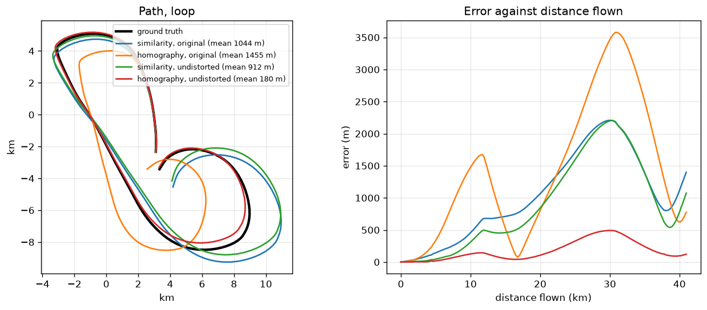
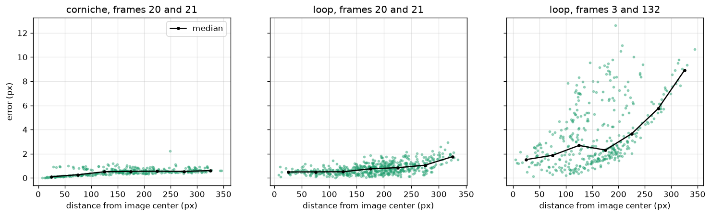
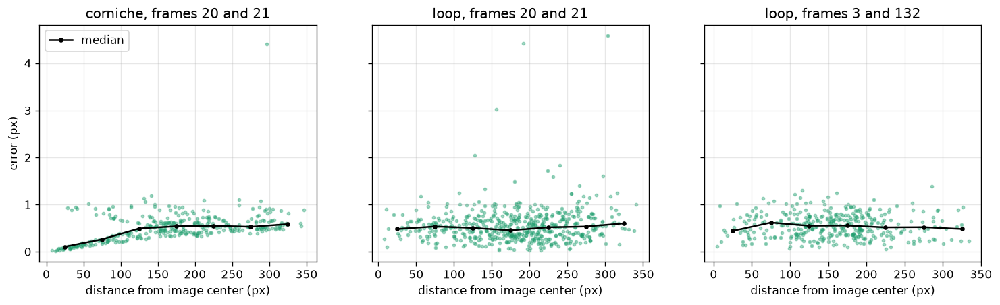

# Bonus: Fix the Camera

The script is `code/bonus.py` (run `python bonus.py`; everything is written to `results/bonus/`).

## Method

The camera of loop and lost_at_sea has radial distortion, `pd = c + (p - c)(1 + kappa |p - c|^2 / 600^2)`.
A negative `kappa` pulls points toward the center (barrel distortion).

1. **Finding kappa from our matches.** The ground is flat, so once the distortion is removed, the matches
   between two frames agree with a single homography. For each `kappa` on a grid (coarse, then fine), we
   undistort the matched points of frame pairs 3 frames apart, fit a homography with RANSAC, and take the
   mean of `min(error^2, 2^2)` over all matches as the cost. The `kappa` with the smallest cost wins.

2. **Undistort the frames** with `cv2.remap` and repeat Q3.2 on them.

Result: `kappa = -0.120` on loop and `-0.116` on lost_at_sea, and `+0.004` on corniche, which is zero within
the noise, as it should be because corniche has no distortion (`bonus_kappa.png`).

## Q3.2 again

Mean and final error of the chained path, on the original and on the undistorted frames:

| flight | kappa | model | mean before (m) | final before (m) | mean after (m) | final after (m) |
|---|---|---|---|---|---|---|
| corniche | +0.004 | similarity | 280 | 578 | 304 | 618 |
| corniche | +0.004 | homography | 56 | 127 | 59 | 252 |
| loop | -0.120 | similarity | 1044 | 1399 | 912 | 1074 |
| loop | -0.120 | homography | 1455 | 777 | 180 | 122 |
| lost_at_sea | -0.116 | similarity | 1642 | 2988 | 1019 | 1807 |
| lost_at_sea | -0.116 | homography | 1944 | 2568 | 17996 | 4719 |

## Comprison:

- **The homography wins on both flights.** On loop it has a mean error of 180 m against 912 m for the
  similarity (final error 122 m against 1074 m). On corniche it already won (56 m against 280 m), and nothing
  important changes there, because there is no distortion to remove. Aligns with lect, since the
  ground is nearly flat, so the motion between two frames is a homography, and a similarity ignores the tilt
  of the aircraft.
- **Before the fix, loop was the exception:** the similarity was better (1044 m against 1455 m). A homography
  cannot represent radial distortion, so the errors at the edge of the frame distort its fit, and chaining
  137 steps amplifies them. The match-error plot shows this: on loop the error grows with the distance from
  the image center (`bonus_error_vs_radius_raw.png`), while on corniche it is flat. After undistortion the
  loop plots are flat too (`bonus_error_vs_radius_undistorted.png`), so the radius-dependent error is gone.
