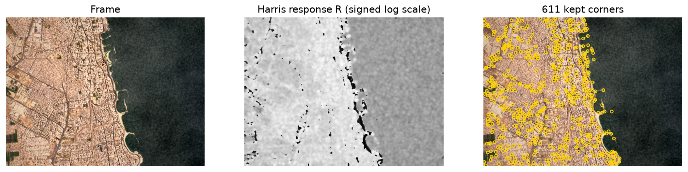
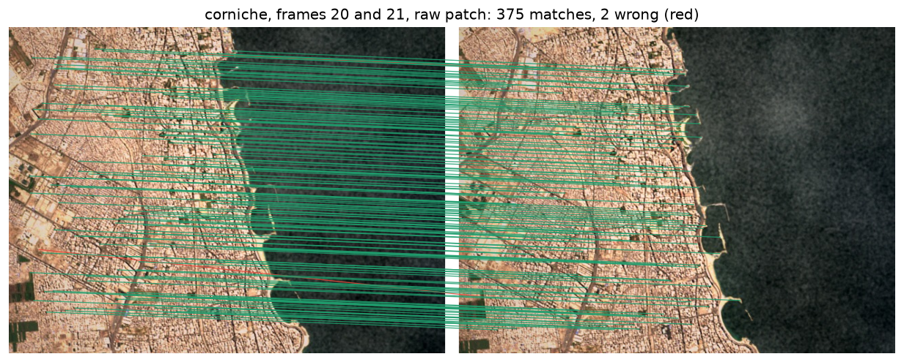
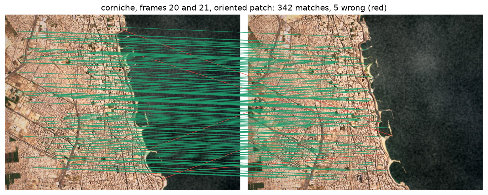
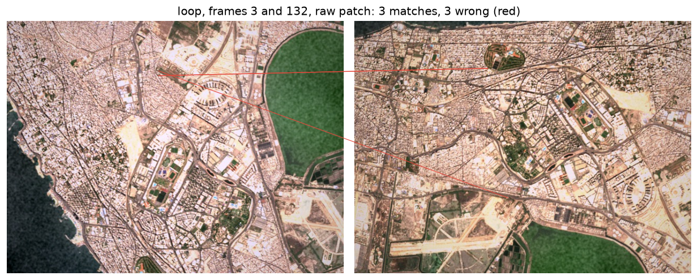
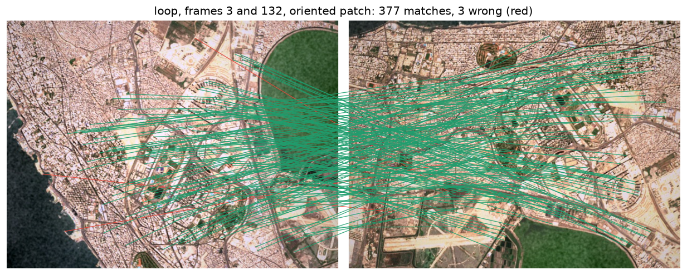

## Part 1: Features That Survive Motion
### Q1.1: Harris Corners

### Q1.2: Descriptors and Matching
1. Cornich Frames:
    - Raw Patch:

    - Oriented Patch:

2. Loop Frames:
    - Raw Patch:
    
    - Oriented Patch:
    

It can be noticed that when using consecutive images (with negligible change in orientation), the performance is almost similar with a slight degradation in the oriented version: 2 wrong matches out of 375 in the raw patch (error ≈ 0.5%) and 5 wrong matches out of 342 in the oriented patch (error ≈ 1.46%).

However, when using images with significant change in orientation, feature matching fails when applied to the raw patch but shows significant improvement in performance when applied to the oriented patch: 3 wrong matches out of 3 (error = 100%) in the raw patch and 3 wrong matches out of 377 in the oriented patch (error ≈ 0.79%)