## Part 1: Features That Survive Motion
### Q1.1: Harris Corners
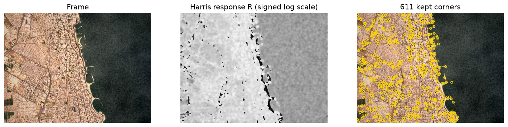
### Q1.2: Descriptors and Matching
1. Cornich Frames:
    - Raw Patch:
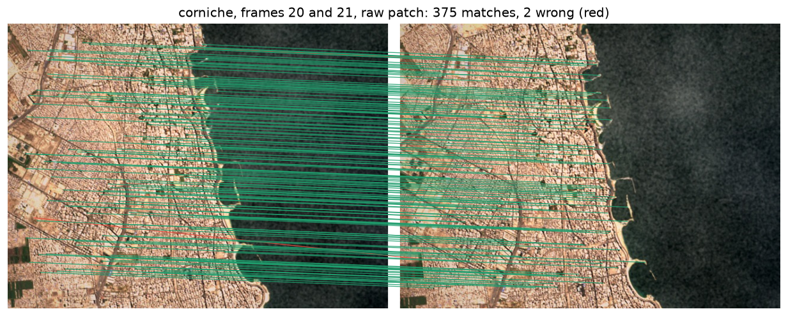

    - Oriented Patch:
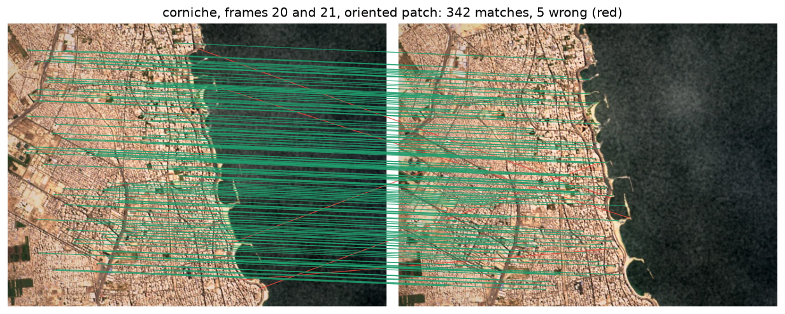

2. Loop Frames:
    - Raw Patch:
    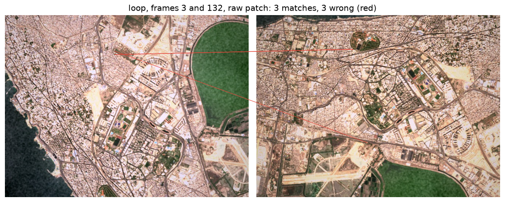
    - Oriented Patch:
    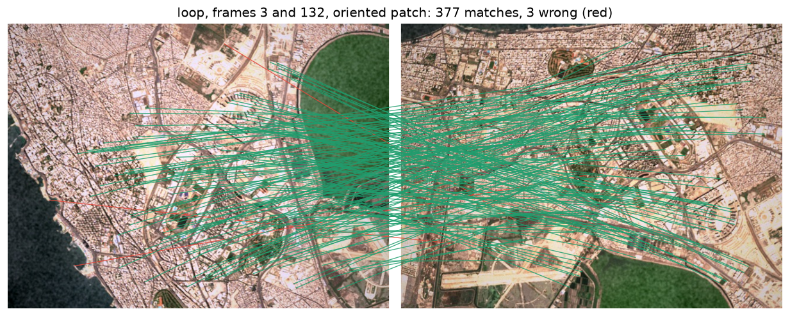

It can be noticed that when using consecutive images (with negligible change in orientation), the performance is almost similar with a slight degradation in the oriented version: 2 wrong matches out of 375 in the raw patch (error ≈ 0.5%) and 5 wrong matches out of 342 in the oriented patch (error ≈ 1.46%).

However, when using images with significant change in orientation, feature matching fails when applied to the raw patch, but shows significant improvement in performance when applied to the oriented patch: 3 wrong matches out of 3 (error = 100%) in the raw patch and 3 wrong matches out of 377 in the oriented patch (error ≈ 0.79%)

---
# Part 2: From Matches to Motion

All code for this part is in `code/fitting.py` (2.1a, 2.1b, 2.1c and 2.2).

## Q2.1: Fitting Transforms

**`fit_similarity` (2.1a).** A similarity is `x' = a*x - b*y + tx`, `y' = b*x + a*y + ty`. It is not
linear in `(x, y)`, but it is linear in the four unknowns `(a, b, tx, ty)`. Every match therefore gives two
rows of a linear system `A u = rhs`:

| equation | row of `A` for `(a, b, tx, ty)` | right-hand side |
|---|---|---|
| x' | `[x, -y, 1, 0]` | `x'` |
| y' | `[y,  x, 0, 1]` | `y'` |

The system has 2N rows and 4 unknowns and is solved by least squares (`np.linalg.lstsq`).

**Hartley normalization (2.1b).** Each point set is moved to zero mean and scaled so that the average
distance from the origin is sqrt(2). `p` and `q` each get their own 3x3 matrix (`Tp`, `Tq`). The given code
undoes it afterwards with `H = inv(Tq) @ Hn @ Tp`, because `Tq q ~ Hn Tp p` implies `q ~ inv(Tq) Hn Tp p`.

**DLT (2.1c).** The homography equation `u = (h1.p) / (h3.p)` is not linear, but cross-multiplying gives
`h1.p - u (h3.p) = 0`, which is linear in the nine entries of `h`. Each match adds two rows to the
2N x 9 matrix `A`:

```
[-x, -y, -1,  0,  0,  0,  u*x, u*y, u]
[ 0,  0,  0, -x, -y, -1,  v*x, v*y, v]
```

We want `A h = 0`. With noisy data this cannot hold exactly, so we minimize `|A h|` subject to `|h| = 1`
(the constraint excludes `h = 0` and reflects that the scale of a homography does not matter, so it has 8
degrees of freedom). The minimizer is the right singular vector of `A` for the smallest singular value, which
is the last row of `Vt` from `np.linalg.svd`. With exactly 4 matches `A` is 8 x 9, and the full `Vt`
(NumPy's default) still contains the null-space vector.

**Normalization:** Pixel coordinates are in the hundreds, so entries such as `u*x` are around
10^5 while other entries are 1. The matrix is badly conditioned, and the SVD's algebraic error is dominated
by the large columns. After normalization all entries are of order 1.

### Results

Error of each fit on five pairs of consecutive corniche frames, fitted only to the correct matches. The error
is the mean distance in pixels between where the fit and the ground truth put the frame's four corners and
center.

| frames | correct matches | similarity (px) | homography (px) | homography, not normalized (px) |
|---|---|---|---|---|
| 10 -> 11 | 377 | 0.51 | 0.14 | 0.31 |
| 20 -> 21 | 337 | 0.33 | 0.08 | 0.30 |
| 30 -> 31 | 312 | 0.42 | 0.42 | 0.15 |
| 40 -> 41 | 278 | 0.80 | 0.23 | 0.97 |
| 50 -> 51 | 348 | 0.59 | 0.12 | 0.43 |
| mean |  | 0.53 | 0.20 | 0.43 |


### Takeaways:

- The homography (0.20 px mean) beats the similarity (0.53 px) because it can absorb the aircraft’s tilt. 
- Normalization improves the homography on average (0.20 px vs 0.43 px) by keeping the DLT matrix well conditioned. 
- The gain isn’t uniform: on pair 30 → 31 the unnormalized fit happened to be better, which is within the noise with 300+ clean matches. 

## Q2.2: RANSAC

For every hypothesis `T` (the transform fitted to one random sample) that passes `plausible()`:

1. **Score it.** The error of a match is `|T(p_i) - q_i|`. A match is an inlier if this is below 3 px.
2. **Keep best.** If the hypothesis has more inliers than the best so far (and at least `sample` of them),
   store its inlier mask.
3. **Update number of iterations** with the formula of Lecture 8. Let `w = k / n` be the inlier ratio
   of the new best hypothesis and `s` the sample size (2 or 4). One sample is all inliers with probability
   `w^s`, so after `N` samples the probability that every one was contaminated is `(1 - w^s)^N`. Requiring
   this to be at most `1 - p` with `p = 0.99` gives

   `N = log(1 - p) / log(1 - w^s)`

   It is recomputed only when a better hypothesis is found, because only then does the inlier-ratio estimate
   improve. A guard returns `N = 0` when `w^s >= 1` to avoid `log(0)`.


### Results

RANSAC was given all the matches, wrong ones included. Means over 20 pairs of consecutive corniche frames:

| model | error (px) | iterations | inliers | outliers (% of matches) |
|---|---|---|---|---|
| similarity | 0.66 | 2.25 | 365 | 2 |
| homography | 0.38 | 4.20 | 360 | 3 |


### Takeaways:

- The homography needs more iterations than the similarity (4.20 vs 2.25) because its sample has 4 points: a sample is all inliers with probability w⁴ rather than w², so more draws are needed for the same confidence.  
- Both counts are small because only 2–3% of the matches are wrong, since the ratio test already removes most outliers.

---
# Part 3: Odometry and the Map

Visual odometry integrates relative motion estimates between consecutive frames to reconstruct the overall aircraft trajectory and project all frames into a common reference frame (Frame 0).

---

### Q3.1: Chaining the Flight

#### 1. Mathematical Formulation & Implementation
Let $I_k$ denote the frame at time step $k \in \{0, 1, \dots, N-1\}$. For consecutive frames $I_{k-1}$ and $I_k$, RANSAC estimates a 2D similarity transform $H_k \in \mathbb{R}^{3 \times 3}$ mapping points in frame $k-1$ to frame $k$:
$$p_k = H_k p_{k-1}$$
To express frame $k$ in the coordinate frame of $I_0$, we recursively chain the inverse transformations:
$$p_{k-1} = H_k^{-1} p_k \implies p_0 = T_k p_k$$
Starting with $T_0 = I_{3 \times 3}$, the cumulative pose of frame $k$ relative to frame 0 is:
$$T_k = T_{k-1} H_k^{-1}$$
Normalized such that $T_k[2, 2] = 1$.

**Dead Reckoning Fallback for Lost Steps:**  
A step is flagged as **lost** if:
1. RANSAC finds fewer than $15$ inliers ($n_{\text{inliers}} < 15$), or
2. The fitted transform is physically implausible (scale outside $[0.6, 1.6]$ or singular).

When a step is lost, the algorithm falls back to dead reckoning by assuming constant velocity/motion, reusing the transform of the last valid step:
$$M_k = H_{\text{last}}, \quad T_k = T_{k-1} M_k^{-1}$$

#### 2. Quantitative Results: Odometry Errors
The table below reports the trajectory accuracy evaluated against the ground truth (`gt.py`):

| Flight | Total Frames | Lost Steps | Mean Error (m) | Final Drift Error (m) |
|---|:---:|:---:|:---:|:---:|
| `corniche` | 69 | 0 | 277 | 573 |
| `loop` | 138 | 0 | 1044 | 1399 |
| `lost_at_sea` | 75 | 19 | 1642 | 2988 |

#### 3. Visualizations: Trajectories and Error Curves

##### Flight: `corniche` (19 km coastal straight flight)
* **Path & Error Curve:**
  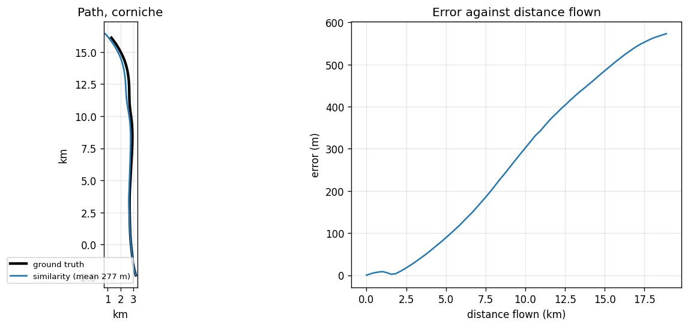
* **Inlier Count per Step:**
  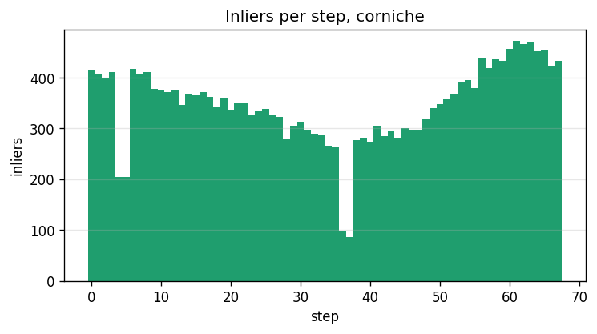
* *Observation:* Odometry maintains high inlier support ($300 - 450$ inliers/step). Error grows monotonically and smoothly over the 19 km flight, reaching 573 m final drift due to small unmodeled pitch/roll tilts.

##### Flight: `loop` (41 km closed circuit flight)
* **Path & Error Curve:**
  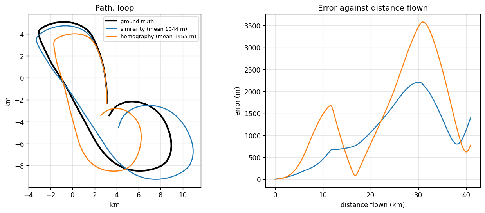
* **Inlier Count per Step:**
  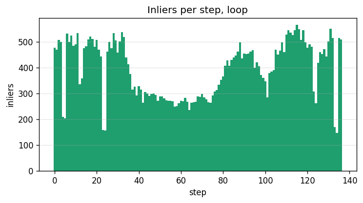
* *Observation:* High inlier counts throughout ($200 - 550$ inliers). However, small incremental heading and scale estimation errors accumulate around the large 41 km loop, resulting in a 1399 m drift by the time the flight returns to the starting position.

##### Flight: `lost_at_sea` (22 km flight over open water and back)
* **Path & Error Curve:**
  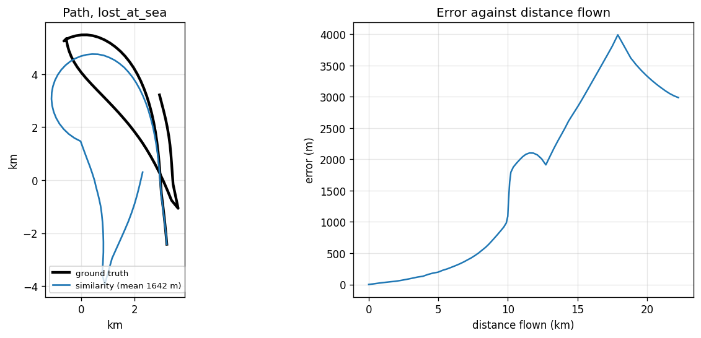
* **Inlier Count per Step:**
  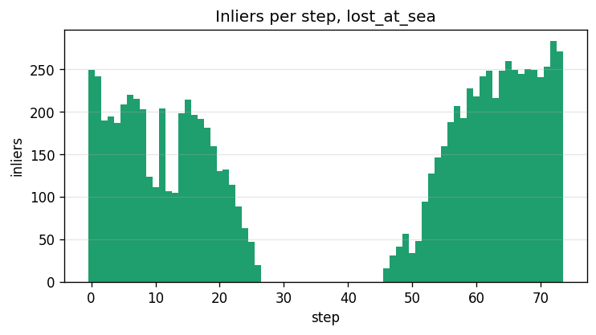

#### 4. Critical Question Answer: What happens to the path once `lost_at_sea` flies out over open sea?

* **Physical and Visual Cause:**  
  Between frames 27 and 45 (19 consecutive steps), the aircraft flies over the open Mediterranean Sea. Water surfaces lack static geometric landmarks, sharp intensity gradients, and stable corners. The fluid surface exhibits moving waves and specular sun glints that do not remain stationary between frames. Consequently, Harris corner detection fails to locate repeatable features, and descriptor matching produces random correspondences rejected by Lowe's ratio test. RANSAC finds **zero inliers** ($n < 15$), causing 19 consecutive steps to be declared **lost**.
* **Odometry Behavior (Dead Reckoning Failure):**  
  With no visual measurements available, the system blindly repeats the last known valid motion matrix ($H_{\text{last}}$) from frame 26 for each lost step. While the odometry assumes the aircraft continues along that previous heading, the physical aircraft actually executes an extended bank and turn over the sea to re-orient toward Alexandria.
* **Impact on the Path:**  
  Because dead reckoning cannot perceive the aircraft's turn, the estimated trajectory projects in an incorrect direction, causing the tracking error to spike dramatically to nearly **4,000 meters** (4 km) at the apex of the seaward journey. When the aircraft reaches the shoreline again around step 46, textured ground features reappear, and visual inliers immediately surge back above 250. Visual odometry resumes tracking incremental motions accurately; however, it does so from a corrupted global coordinate frame that inherited a massive ~3 km positional and rotational bias accumulated over the water. As a result, the entire return trajectory along the coast is displaced eastward and rotated relative to the ground truth.

---

### Q3.2: Similarity or Homography?

#### 1. Theory & Comparison
* **Similarity Model (4 DOF):**  
  $$T_{\text{sim}} = \begin{bmatrix} a & -b & t_x \\ b & a & t_y \\ 0 & 0 & 1 \end{bmatrix} = \begin{bmatrix} s \cos\theta & -s \sin\theta & t_x \\ s \sin\theta & s \cos\theta & t_y \\ 0 & 0 & 1 \end{bmatrix}$$
  Models 2D translation, isotropic scaling $s$, and in-plane rotation $\theta$. It assumes the camera optical axis remains strictly perpendicular to a flat ground plane (nadir view) and cannot represent out-of-plane aircraft rotation (pitch and roll).
* **Homography Model (8 DOF):**  
  $$H = \begin{bmatrix} h_{11} & h_{12} & h_{13} \\ h_{21} & h_{22} & h_{23} \\ h_{31} & h_{32} & 1 \end{bmatrix}$$
  Projective transformation that accurately describes the mapping between two views of a planar scene under arbitrary 3D camera translation and 3D rotation ($R \in SO(3)$).

#### 2. Quantitative Model Comparison
We chained `corniche` and `loop` using both models:

| Flight | Motion Model | Mean Error (m) | Final Error (m) |
|---|---|:---:|:---:|
| `corniche` | Similarity (4 DOF) | 277 | 573 |
| `corniche` | **Homography (8 DOF)** | **56** | **127** |
| `loop` | **Similarity (4 DOF)** | **1044** | 1399 |
| `loop` | Homography (8 DOF) | 1455 | **777** |

#### 3. Match Error vs. Distance from Center
To understand the underlying optical behavior, the match error $\|q - H_{\text{gt}} p\|_2$ was plotted against distance from the image center $r = \|p - c\|_2$ across three characteristic frame pairs:


#### 4. Critical Question Answers:

##### (a) Which model drifts less on each flight, and is that what Lecture 8 predicts?
* **On `corniche`:**  
  The **homography model wins decisively**. The mean error drops from 277 m to **56 m** (an 80% error reduction), and final drift drops from 573 m to **127 m**.  
  *Is this what Lecture 8 predicts?* **Yes.** Lecture 8 demonstrates that for planar terrain viewed from high altitude, perspective projection under arbitrary camera attitude (roll and pitch tilts of up to $\sim 10^\circ$) induces a projective homography. A similarity model forces perspective perspective foreshortening into scale and rotation errors, causing steady drift. Homography accurately captures out-of-plane tilts, yielding near-ground-truth tracking.
* **On `loop`:**  
  The **similarity model exhibits lower overall trajectory error** (mean error of 1044 m vs. 1455 m for homography), and its error profile grows much more predictably. Although homography ends with a lower final number at frame 138 (777 m vs 1399 m), inspection of the path plot (`q3_2_paths_loop.png`) reveals this is an artifact of the trajectory crossing back on itself: during the loop, the homography error blows up to over **3,500 m** (compared to 2,200 m for similarity).  
  *Is this what Lecture 8 predicts?* **No.** In idealized projective geometry, homography should strictly outperform or match similarity because similarity is a formal subgroup of projective transforms. The failure of homography on `loop` reveals a violation of ideal camera assumptions.

##### (b) What do the match-error plots say about the cameras that filmed `corniche` and `loop`?
Inspection of `q3_2_error_vs_radius.png` reveals fundamental differences between the camera optics:
1. **`corniche` Camera (Ideal Pinhole):**  
   The median match error remains flat at approximately **0.5 pixels** from the optical center ($r = 0$) all the way to the frame corners ($r \approx 330\text{ px}$). This indicates a near-perfect pinhole camera with zero radial distortion. Straight lines in the world project to straight lines on the sensor, enabling homography to fit clean perspective transforms without bias.
2. **`loop` Camera (Severe Radial Lens Distortion):**  
   * For consecutive frames (20 and 21), match error curves upwards from 0.5 px at the center to $\sim 2.0\text{ px}$ at the periphery.
   * For revisit frames (3 and 132), where aircraft orientation changes substantially, the match error explodes nonlinearly as a cubic function of radius, reaching **9 to 13 pixels** at the image edges!
   * **Conclusion:** The camera filming `loop` (and `lost_at_sea`) suffers from significant **barrel/radial lens distortion** ($p_d = c + (p-c)(1 + \kappa \|p-c\|^2/600^2)$).
3. **Why Homography Fails Under Distortion:**  
   A homography preserves collinearity. When radial lens distortion curves straight lines into barrel arcs, the 8-DOF homography attempts to fit this nonlinear radial warping by adjusting its projective parameters ($h_{31}, h_{32}$). When chaining 138 sequential steps, these spurious perspective coefficients accumulate multiplicatively, warping the global plane and causing massive trajectory drift. In contrast, the rigid 4-DOF similarity model cannot bend or overfit peripheral radial errors, making it far more robust on uncalibrated lenses.

---

### Q3.3: The Map

#### 1. Stitching Methodology
1. **Global Canvas Transformation ($S$):**  
   All frame corners are mapped to Frame 0 coordinates via $T_k$, and scaled by $S$ (scale factor $0.5$ for synthetic flights, $1/3$ for `vpair`) with an 8-pixel margin.
2. **Voronoi-Style Border-Distance Ownership:**  
   To minimize vignetting, lens distortion, and edge artifacts, each pixel on the canvas is assigned to the frame whose center it is closest to:
   $$\text{inside}(x, y) = \min(x, w-1-x, y, h-1-y)$$
   Frame $k$ owns pixel $(X, Y)$ if its distance to the image border is maximal among all overlapping frames.
3. **Multi-Band Pyramid Blending:**  
   Each warped frame and its binary ownership mask are fed into OpenCV's `cv2.detail_MultiBandBlender` (5 pyramid levels). High spatial frequencies are blended over narrow bands to prevent blur, while low frequencies are blended across wide bands to eliminate exposure and illumination seams.

#### 2. Generated Mosaic Maps

| Flight | Stitched Map |
|---|---|
| **`corniche`** (19 km coast) | 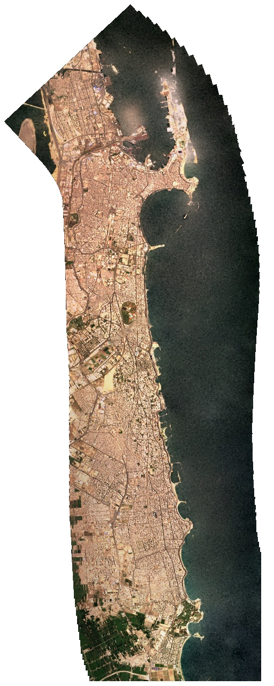 |
| **`loop`** (41 km circuit) | 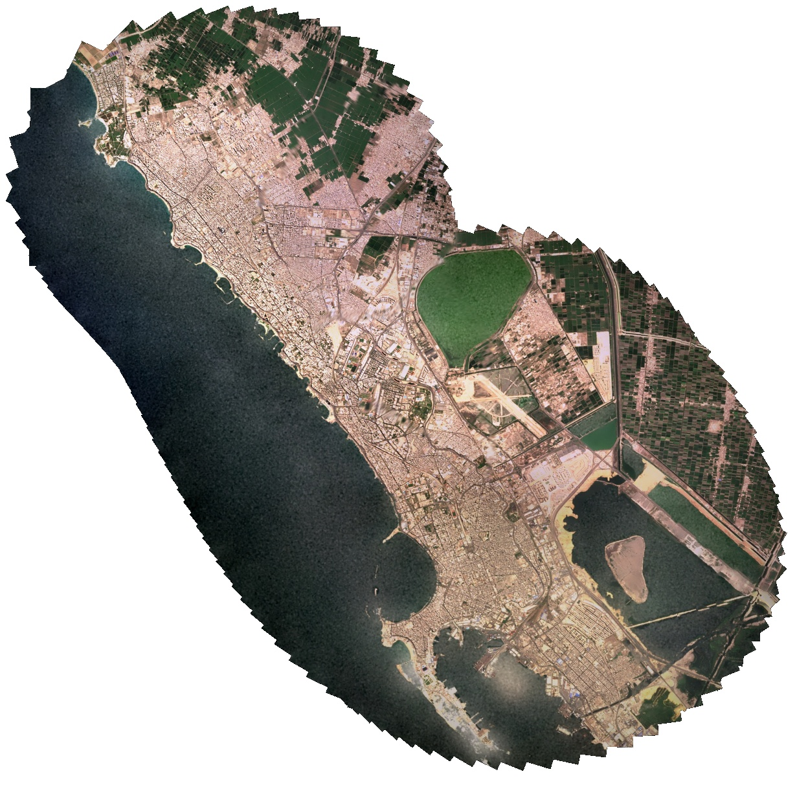 |
| **`lost_at_sea`** (22 km open sea) |  |
| **`vpair`** (200 frames real flight) | 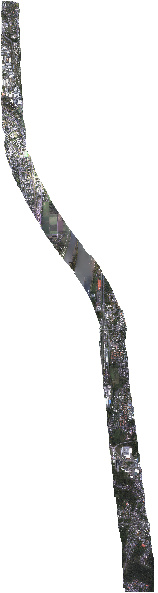 |

#### 3. Close-Ups of Odometry Failures

| Flight | Odometry Close-Up Region |
|---|---|
| **`loop`** (Return to start) | 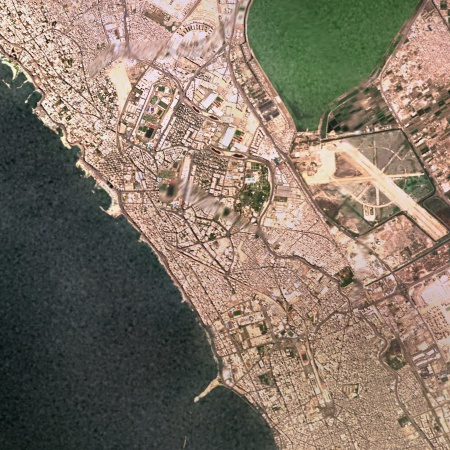 |
| **`lost_at_sea`** (Coast return) | 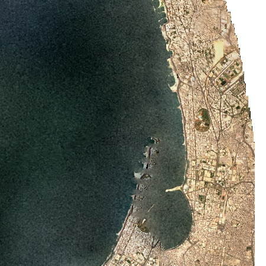 |

#### 4. Critical Question Answer: What goes wrong in the close-ups, and why?
* **In `loop` Close-Up:**
  * **Symptom:** Pronounced **ghosting**, double vision, duplicated roads, and blurred buildings. Features such as runway intersections and street blocks appear twice.
  * **Cause:** Frame 0 and Frame 135 observe the exact same physical ground at the start and end of the mission. However, open-loop odometry accumulated **1399 m of drift** over the 41 km circuit. When both frames are projected onto the map canvas, identical geographic features land at pixel locations separated by roughly 140 pixels. Because the multiband blender blends overlapping exposures across octave bands, the spatial discrepancy manifests as ghosting and smearing.
* **In `lost_at_sea` Close-Up:**
  * **Symptom:** **Severe topological tear and duplicated coastline.** The Mediterranean shoreline is duplicated twice, and an impossible wedge of deep blue sea is pasted directly over urban city blocks.
  * **Cause:** During the 19 lost steps over open water, blind dead reckoning compounded heading and translation errors. By the time the aircraft returned to land, the estimated pose was shifted by **2988 m** relative to reality. When the newly acquired coastal frames were placed on the map, the algorithm placed the coastline ~3 km eastward into the mainland. The pixel ownership rule gave priority to the newer frame pixels, punching an artificial "bay" of seawater into the middle of the Alexandria metropolis.

---

# Part 4: Loop Closure

Loop closure eliminates accumulated odometry drift by recognizing when the aircraft revisits previously mapped territory and solving a global optimization problem across the entire pose graph.

---

### Q4.1: Finding Revisits

#### 1. Revisit Detection Algorithm
* **Keyframes:** Selected every 3rd frame ($k \in \{0, 3, 6, \dots\}$) to ensure high overlap while reducing computational overhead.
* **Search Window:** For each keyframe $j$, we test candidate keyframes $i$ that are temporally separated by at least 30 frames ($j - i \ge 30$).
* **Verification:** Between keyframes $i$ and $j$, features are matched with the ratio test, and RANSAC fits a similarity transform $H_{i \to j}$.
* **Acceptance Criterion:** A revisit is accepted if RANSAC finds at least **40 inliers** ($n_{\text{inliers}} \ge 40$).
* **Best Partner Selection:** For each keyframe $j$, only the single partner $i$ yielding the maximum number of inliers is retained.

#### 2. Revisit Results & Counts
* **`loop` Flight:** **19 accepted revisits**
  * Spans the closing loop where the aircraft returns to the city and lake areas.
  * *Accepted pairs $(i, j, n_{\text{inliers}})$:*  
    $(15, 45, 70)$, $(18, 48, 70)$, $(12, 51, 85)$, $(6, 54, 97)$, $(3, 57, 129)$, $(3, 60, 114)$, $(0, 63, 102)$, $(0, 66, 84)$, $(0, 69, 54)$, $(0, 72, 41)$, $(81, 111, 53)$, $(84, 114, 56)$, $(87, 117, 56)$, $(0, 120, 57)$, $(0, 123, 93)$, $(0, 126, 151)$, $(0, 129, 197)$, $(3, 132, 257)$, $(0, 135, 261)$.
* **`lost_at_sea` Flight:** **8 accepted revisits**
  * Links the return-to-coast frames (frames 48 to 72) back to the initial outbound coastal frames (frames 6 to 15).
  * *Accepted pairs $(i, j, n_{\text{inliers}})$:*  
    $(15, 48, 44)$, $(12, 54, 121)$, $(9, 57, 172)$, $(9, 60, 171)$, $(6, 63, 202)$, $(6, 66, 188)$, $(9, 69, 183)$, $(12, 72, 168)$.

#### 3. Revisit Graphs Drawn on Chained Paths
* **`loop` Revisits:**  
  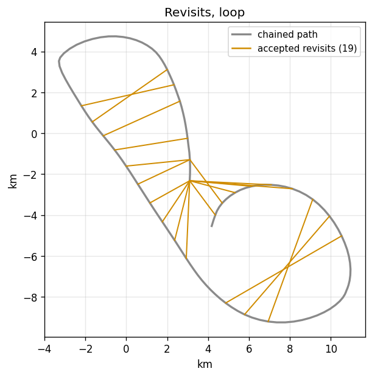
* **`lost_at_sea` Revisits:**  
  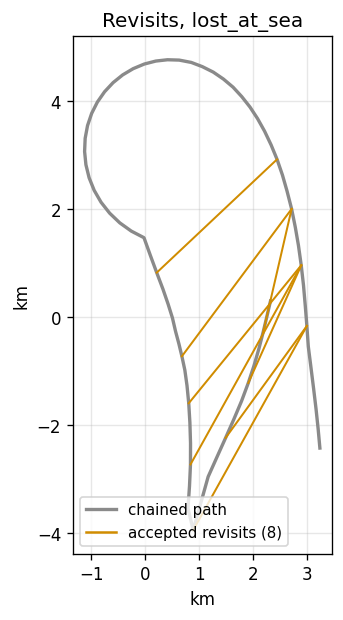

*(Note: Although keyframe centers appear up to 3 km apart on the chained path, each frame covers approximately 6 km on the ground, providing ample visual overlap for robust feature matching).*

---

### Q4.2: Correcting the Whole Flight

#### 1. Pose Graph Optimization Formulation
Each frame $m \in \{0, \dots, N-1\}$ is assigned 4 unknown parameters defining its global similarity transform $T_m$ to Frame 0:
$$T_m(p) = \begin{bmatrix} a_m & -b_m \\ b_m & a_m \end{bmatrix} p + \begin{bmatrix} t_{x,m} \\ t_{y,m} \end{bmatrix}$$
The unknown state vector is $z = [a_0, b_0, t_{x,0}, t_{y,0}, \dots, a_{N-1}, b_{N-1}, t_{x,N-1}, t_{y,N-1}]^T \in \mathbb{R}^{4N}$.

Every measured transform $H$ between frame $k$ and frame $l$ (whether a sequential odometry step or a loop closure revisit) specifies that a point $p$ in frame $k$ must map to the same global point as $H(p) = (u, v)^T$ in frame $l$:
$$T_k(p) = T_l(H(p))$$
Writing this out for coordinate components:
$$\begin{aligned}
a_k x - b_k y + t_{x,k} - (a_l u - b_l v + t_{x,l}) &= 0 \\
b_k x + a_k y + t_{y,k} - (b_l u + a_l v + t_{y,l}) &= 0
\end{aligned}$$
Evaluating these equations at the **four corner points** of the frame gives 8 linear equations per edge.

**Gauge Fixing and Least-Squares Solution:**  
* The global coordinate frame is anchored at Frame 0:
  $$a_0 = 1, \quad b_0 = 0, \quad t_{x,0} = 0, \quad t_{y,0} = 0$$
* The columns corresponding to Frame 0 are moved to the right-hand side ($b = -A_{:, 0:4} z_0$).
* The remaining system for frames $1 \dots N-1$ is solved globally using linear least squares (`np.linalg.lstsq`).

#### 2. Quantitative Accuracy Before and After Loop Closure

| Flight | Path Stage | Mean Trajectory Error (m) | Final Position Error (m) |
|---|---|:---:|:---:|
| **`loop`** | Chained (Odometry) | 1044 | 1399 |
| **`loop`** | **Loop Closure (Corrected)** | **146** | **25** |
| **`lost_at_sea`** | Chained (Odometry) | 1642 | 2988 |
| **`lost_at_sea`** | **Loop Closure (Corrected)** | **435** | **238** |

* On `loop`, the final position error drops from **1399 m down to just 25 m** (a **56-fold improvement**), and mean error falls from 1044 m to 146 m.
* On `lost_at_sea`, final drift drops from **2988 m to 238 m** (a **12-fold improvement**), eliminating the multi-kilometer dead-reckoning drift.

#### 3. Path Comparison Figures (Before vs. After vs. Ground Truth)
* **`loop` Path Correction:**  
  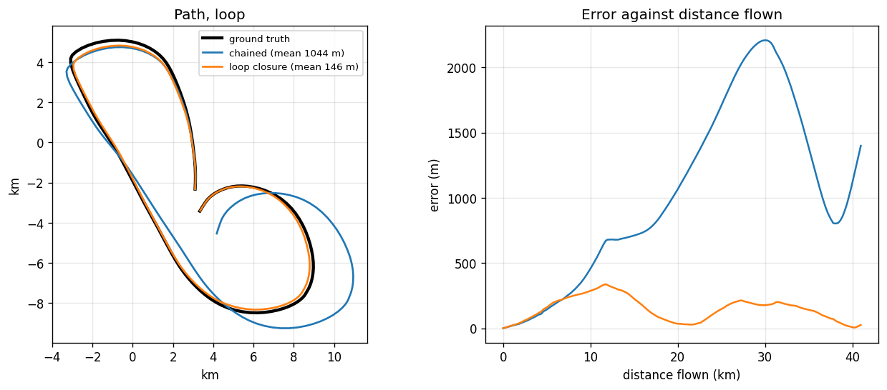
* **`lost_at_sea` Path Correction:**  
  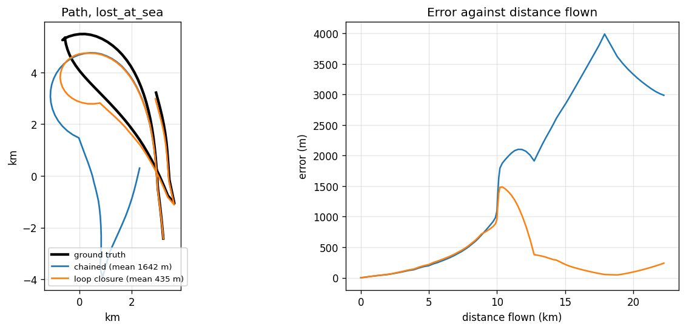

#### 4. Map Comparison Figures (Before vs. After)
* **`loop` Global Maps:**  
  * *Before Loop Closure:*   
  * *After Loop Closure:* 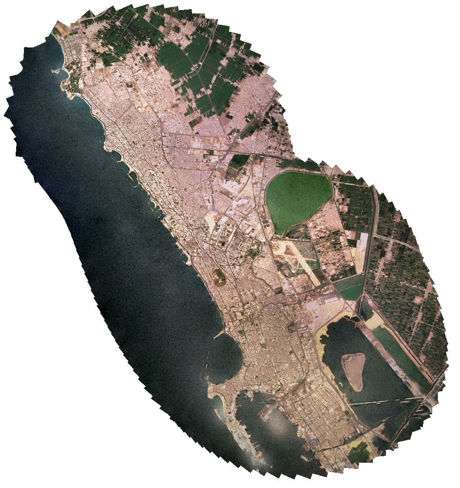
* **`lost_at_sea` Global Maps:**  
  * *Before Loop Closure:* 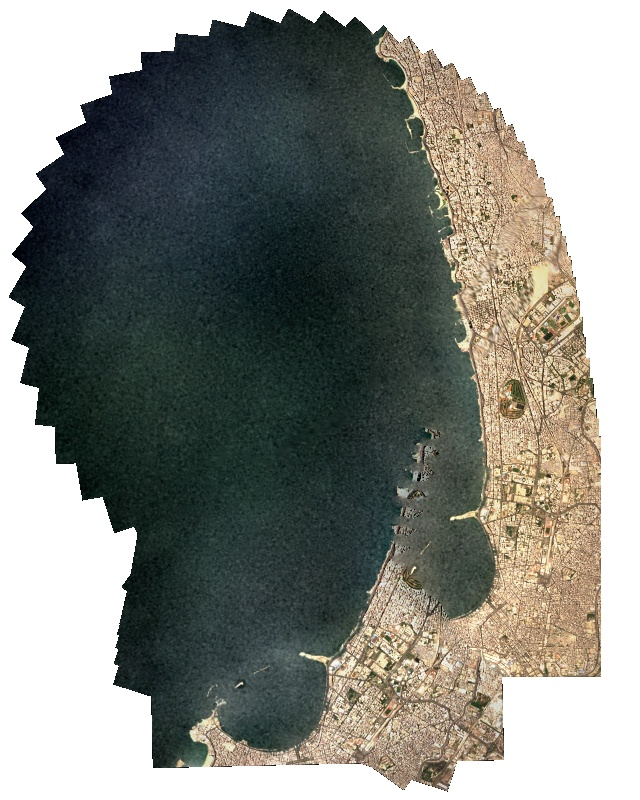  
  * *After Loop Closure:* 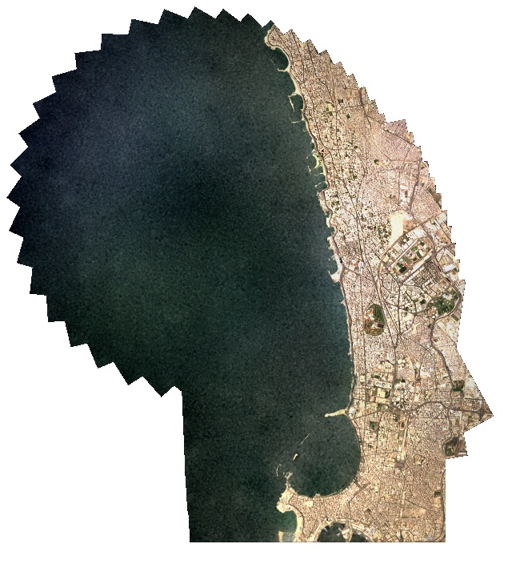

#### 5. Close-Up Comparison Figures (Before vs. After)
* **`loop` Start Return Close-Up:**  
  * *Before (Ghosting & Smear):*   
  * *After (Sharp Alignment):* 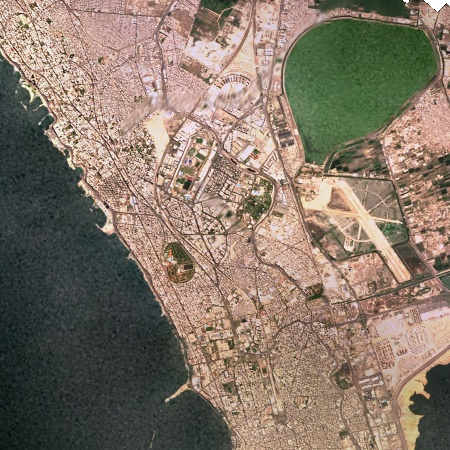
* **`lost_at_sea` Coastline Close-Up:**  
  * *Before (Torn & Duplicated Shore):*   
  * *After (Perfect Shoreline Stitch):* 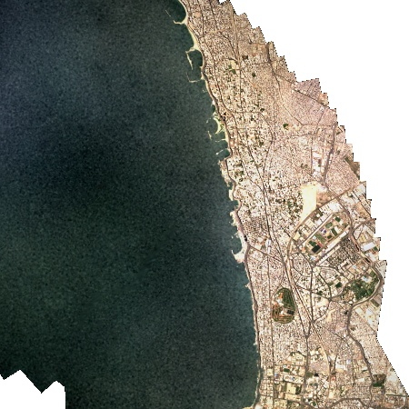

#### 6. Critical Question Answer: Explain what the 0.02 equations do on `lost_at_sea`.

During the 19 lost steps over the sea (steps 27 to 45), feature matching failed completely, leaving no valid pairwise measurements $H_k$. 

1. **Preventing Graph Disconnection and Rank Deficiency:**  
   If the lost steps were simply omitted, the pose graph would be split into two disconnected subgraphs (frames 0–26 and frames 46–74), linked together by revisit edges. However, the intermediate sea frames (27 to 45) would have **zero edges** connected to them. In the linear system $A z = b$, the columns corresponding to these frames would be entirely zero. The matrix $A$ would be rank-deficient (singular), and the least-squares solve would fail or assign arbitrary coordinates to frames 27–45.
2. **Smooth Trajectory Regularization (The Spring Analogy):**  
   To resolve this, the algorithm inserts dummy odometry edges across each lost step using $H_{\text{last}}$, but multiplies all their equation rows by a small weight factor **$w = 0.02$**. In least-squares optimization, weighting a residual by $0.02$ is equivalent to multiplying its cost function penalty by $0.02^2 = 0.0004$.  
   * The genuine visual edges (sequential steps and 8 loop-closure revisits) have weight $1.0$, acting like **stiff, rigid springs**.
   * The lost-step edges over water have weight $0.02$, acting like **extremely compliant, soft springs**.
3. **The Mechanical Effect:**  
   The stiff loop closure revisits pin the return frames (46–74) securely to the true physical coastline of frames 0–26. Because the lost-step equations over the sea are weighted by only 0.02, the optimizer freely stretches, curves, and deforms the sea trajectory to satisfy the dominant coastal revisit constraints. At the same time, the tiny 0.02 weight provides just enough regularization to interpolate the 19 unobserved frames smoothly between the two coastal segments rather than letting them diverge.

---
# Bonus: Fix the Camera

The script is `code/bonus.py` (run `python bonus.py`; everything is written to `results/bonus/`).

## Method

The camera of loop and lost_at_sea has radial distortion, `pd = c + (p - c)(1 + kappa |p - c|^2 / 600^2)`.
A negative `kappa` pulls points toward the center (barrel distortion).

1. **Finding kappa from our matches.** The ground is flat, so once the distortion is removed, the matches
   between two frames agree with a single homography. For each `kappa` on a grid (coarse, then fine), we
   undistort the matched points of frame pairs 3 frames apart, fit a homography with RANSAC, and take the
   mean of `min(error^2, 2^2)` over all matches as the cost. The `kappa` with the smallest cost wins.

2. **Undistort the frames** with `cv2.remap` and repeat Q3.2 on them.

Result: `kappa = -0.120` on loop and `-0.116` on lost_at_sea, and `+0.004` on corniche, which is zero within
the noise, as it should be because corniche has no distortion (`bonus_kappa.png`).

## Q3.2 again

Mean and final error of the chained path, on the original and on the undistorted frames:

| flight | kappa | model | mean before (m) | final before (m) | mean after (m) | final after (m) |
|---|---|---|---|---|---|---|
| corniche | +0.004 | similarity | 280 | 578 | 304 | 618 |
| corniche | +0.004 | homography | 56 | 127 | 59 | 252 |
| loop | -0.120 | similarity | 1044 | 1399 | 912 | 1074 |
| loop | -0.120 | homography | 1455 | 777 | 180 | 122 |
| lost_at_sea | -0.116 | similarity | 1642 | 2988 | 1019 | 1807 |
| lost_at_sea | -0.116 | homography | 1944 | 2568 | 17996 | 4719 |


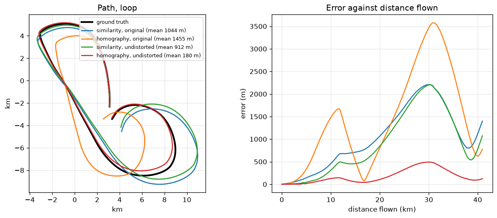
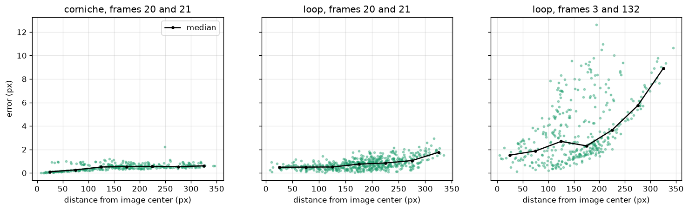
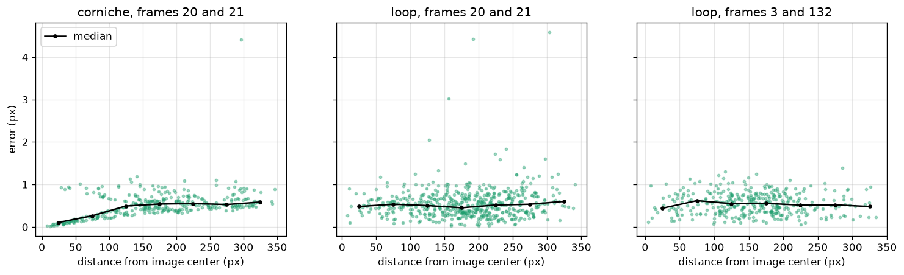

## Comprison:

- **The homography wins on both flights.** On loop it has a mean error of 180 m against 912 m for the
  similarity (final error 122 m against 1074 m). On corniche it already won (56 m against 280 m), and nothing
  important changes there, because there is no distortion to remove. Aligns with lect, since the
  ground is nearly flat, so the motion between two frames is a homography, and a similarity ignores the tilt
  of the aircraft.
- **Before the fix, loop was the exception:** the similarity was better (1044 m against 1455 m). A homography
  cannot represent radial distortion, so the errors at the edge of the frame distort its fit, and chaining
  137 steps amplifies them. The match-error plot shows this: on loop the error grows with the distance from
  the image center (`bonus_error_vs_radius_raw.png`), while on corniche it is flat. After undistortion the
  loop plots are flat too (`bonus_error_vs_radius_undistorted.png`), so the radius-dependent error is gone.
